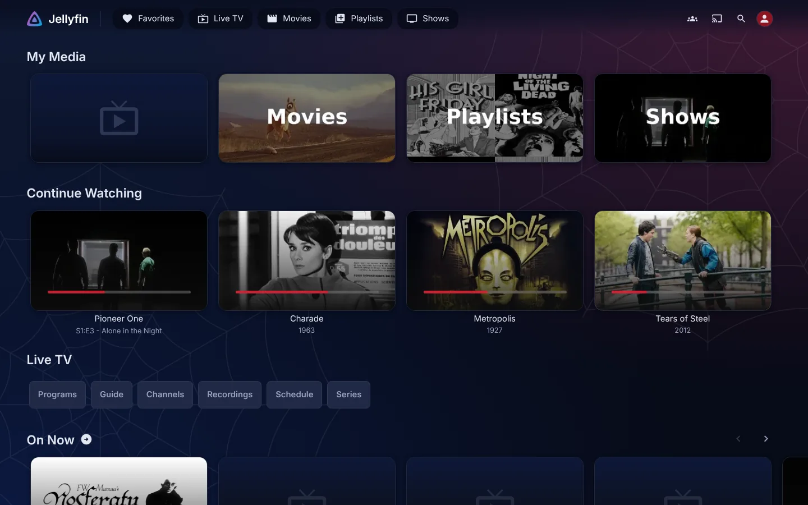
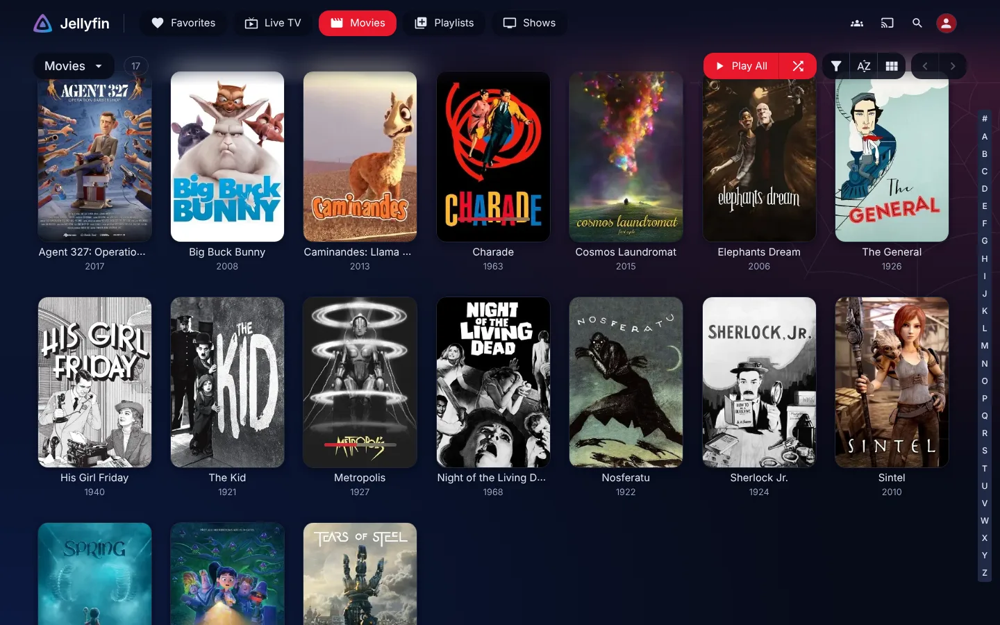
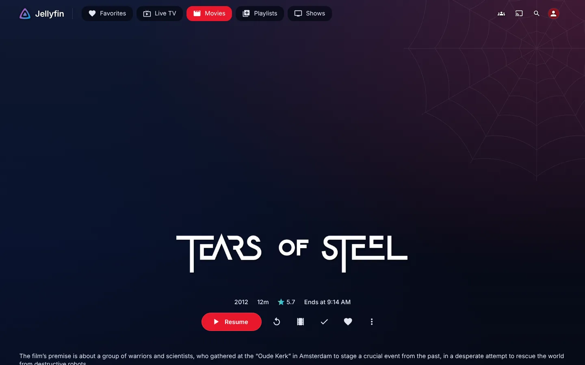
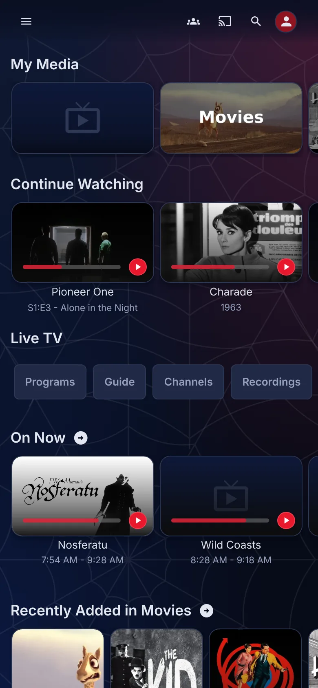
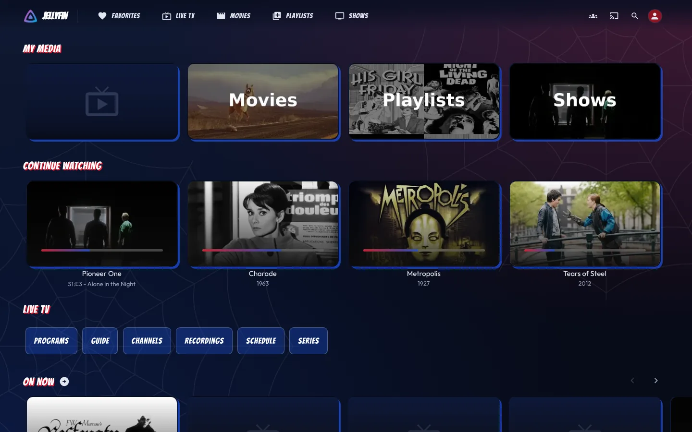
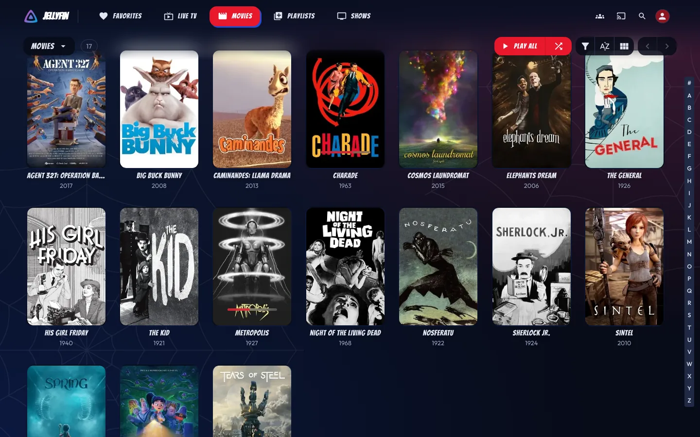
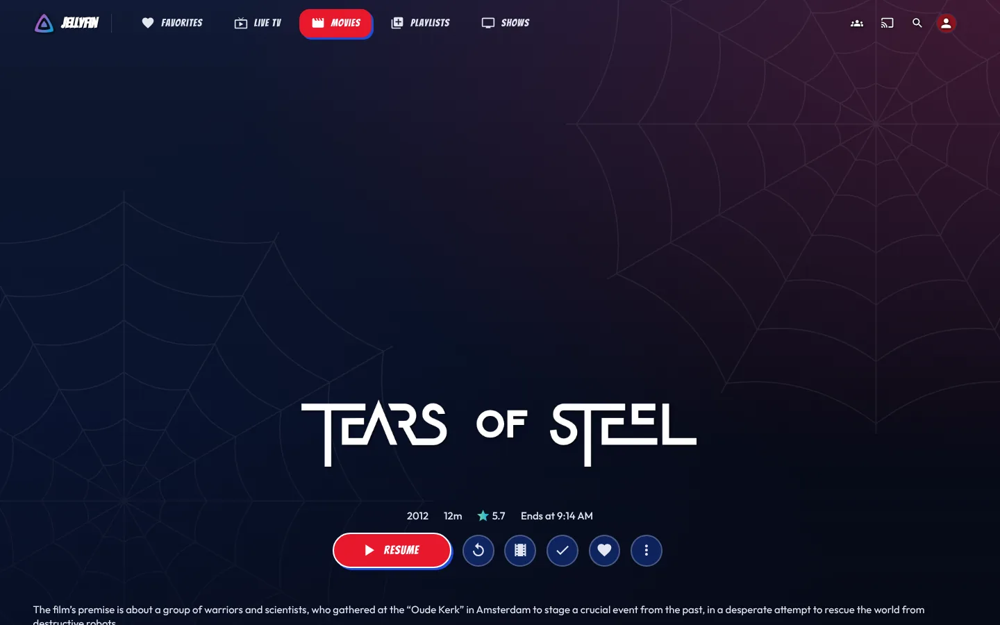
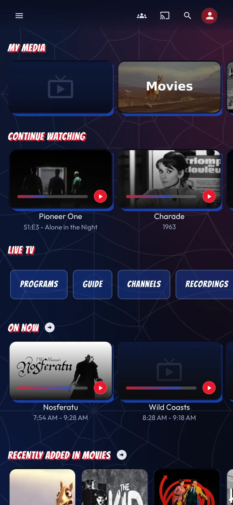

<div align="center">

<h1 align="center">
<br>
<a href="https://github.com/StarKev"></a>
<br>
<b>ElegantSpider</b>
<br>
</h1>

[](https://github.com/StarKev/ElegantSpider/releases)
[](https://jellyfin.org/)
[](https://github.com/lscambo13/ElegantFin)
[](LICENSE)

[English](#english) | [Français](#français)

</div>

---

# English

## Description

**ElegantSpider** is a red & midnight-blue color theme for **Jellyfin**, inspired by Spider-Man's colors and built as a layer on top of **[ElegantFin](https://github.com/lscambo13/ElegantFin)**.

It does not fork or replace ElegantFin: it only overrides its CSS color variables. Every layout, animation, and fix still comes from upstream, so ElegantFin updates keep arriving automatically.

It works with Jellyfin 12's **Modern** layout through the **[ElegantFin for Jellyfin 12](https://github.com/mihaif7/elegantfin-jf12)** companion stylesheet.

## Features

| # | Feature | Description |
|---|---------|-------------|
| 1 | Midnight background | Deep navy gradient with a red glow (top right) and a blue glow (bottom left) |
| 2 | Web watermark | Subtle spider-web patterns in the top-right and bottom-left corners, drawn in pure SVG |
| 3 | Red accent | Play buttons, checkboxes, active tabs, and highlights in vivid red |
| 4 | Progress bars | Resume bars and player seek bar in red |
| 5 | Card hover glow | Red outline and soft glow when hovering posters (desktop) |
| 6 | Matching surfaces | Header, drawer, menus, borders, and tables tinted navy |
| 7 | Scrollbars | Red scrollbars that match the theme |
| 8 | Easy tuning | Three palette variables to recolor the whole theme |
| 9 | Lightweight | ~100 lines, no images to download, no JavaScript |

## Compatibility

| Component | Supported versions |
|-----------|--------------------|
| Jellyfin | 12.0, Modern and Legacy layouts |
| ElegantFin | v26.09.05 or later |
| Clients | Web browsers, Jellyfin Android app, webOS app |
| Theme mode | `Dark` (User Settings → Display → Theme) |

## Installation & Usage

### Option 1 — Server-wide

1. Open **Dashboard → General → Branding**.
2. Paste the following into the **Custom CSS** box:

```css
/* ElegantFin */
@import url("https://cdn.jsdelivr.net/gh/lscambo13/ElegantFin@main/Theme/ElegantFin-jellyfin-theme-build-latest-minified.css");

/* ElegantFin Media Bar add-on */
@import url("https://cdn.jsdelivr.net/gh/lscambo13/ElegantFin@main/Theme/assets/add-ons/media-bar-plugin-support-latest-min.css");

/* ElegantFin Jellyfin 12 companion */
@import url("https://cdn.jsdelivr.net/gh/mihaif7/elegantfin-jf12@main/Theme/ElegantFin-jf12-modern-latest.css");

/* ElegantSpider */
@import url("https://cdn.jsdelivr.net/gh/StarKev/ElegantSpider@main/Theme/ElegantSpider-latest.css");
```

3. Click **Save**, then hard-refresh the page (**Ctrl + F5**).

### Option 2 — Just for you

Paste the same code into **Settings → Display → Custom CSS**.

### Option 3 — Pinned version

To lock a version that will never change, replace the last line with:

```css
@import url("https://cdn.jsdelivr.net/gh/StarKev/ElegantSpider@v1.0.0/Theme/ElegantSpider-latest.css");
```

### Option 4 — Without a URL import

Paste the contents of [`ElegantSpider-latest.css`](Theme/ElegantSpider-latest.css) in place of the last `@import` line.

> **Important:** ElegantSpider must always be loaded **last**. If colors stay indigo, check the import order.

## Tuning

Override any of these after the imports:

```css
:root {
    --es-red: hsl(354, 82%, 50%);
    --es-blue: hsl(224, 76%, 48%);
}
```

| Variable | Default | What it does |
|----------|---------|--------------|
| `--es-red` | `hsl(354, 82%, 50%)` | Main accent color |
| `--es-red-hover` | `hsl(354, 90%, 60%)` | Accent on hover |
| `--es-red-dark` | `hsl(354, 75%, 32%)` | Submit buttons and scrollbars |
| `--es-blue` | `hsl(224, 76%, 48%)` | Focus outline and blue glow |
| `--es-blue-dark` | `hsl(226, 60%, 14%)` | Card backgrounds |
| `--es-navy` | `#070b18` | Darkest background point |
| `--es-navy-2` | `#101a36` | Lightest background point |
| `--es-web` | SVG pattern | Web watermark; set to `none` to remove it |

All of ElegantFin's own options (app bar styles, card buttons, resume card size…) still work.

## Comics add-on (optional)

A second file gives Jellyfin the look of a comic book: **Bangers** titles and buttons, **Outfit** body font, red-bordered cards with a hard blue shadow, red-to-blue progress bars on the Continue Watching row, a red Play button and blue secondary buttons.

Add this line **after** `ElegantSpider-latest.css`:

```css
@import url("https://cdn.jsdelivr.net/gh/StarKev/ElegantSpider@main/Theme/ElegantSpider-comics.css");
```

Fonts are served from `assets/fonts/` through relative paths, so nothing else to install. Both are SIL OFL 1.1 and include French accents.

| Variable | Default | What it does |
|----------|---------|--------------|
| `--es-comic` | `"Bangers", "Impact", sans-serif` | Font for titles and buttons |
| `--es-hard-shadow` | `3px 3px 0 var(--es-blue)` | Hard shadow on buttons |
| `--es-hard-shadow-big` | `6px 6px 0 var(--es-blue)` | Hard shadow on hover |

## Preview

### 🖼️ Theme Showcase

Captured on a real Jellyfin 12.4 server (Modern layout) with ElegantFin, the jf12 companion and ElegantSpider.

<details>
<summary><b>Base theme</b></summary>

| Home | Movies library |
|---|---|
|  |  |
| **Movie page** | **Home on mobile** |
|  |  |

</details>

<details open>
<summary><b>With the comics add-on</b></summary>

| Home | Movies library |
|---|---|
|  |  |
| **Movie page** | **Home on mobile** |
|  |  |

</details>

## Notes

- The `@main` URL always serves the latest version; jsDelivr and your browser can cache it for up to a week, so hard-refresh to update sooner.
- Only the **Dark** theme is styled; Light mode falls back to ElegantFin's own colors.
- Jellyfin Media Player (Qt 5) is not supported by ElegantFin, and therefore not by ElegantSpider.
- The official Android TV app does not support custom CSS.

## Staying in sync with ElegantFin

ElegantSpider never copies ElegantFin's code: users import ElegantFin from its `@main` URL, so every upstream update reaches them automatically.

The only risk is ElegantFin renaming a color variable. A GitHub Action takes care of it:

| When | What it does |
|------|--------------|
| Every Monday | Downloads the latest ElegantFin and jf12 companion and checks that every variable ElegantSpider overrides still exists |
| On failure | Opens an issue listing the missing variables |
| After a push to `Theme/` | Runs the same check, then purges the jsDelivr cache so the new version is served right away |

Run the check locally with `bash scripts/check-elegantfin.sh`.

## Project Structure

```text
ElegantSpider/
├── .github/
│   └── workflows/
│       └── elegantfin-watch.yml
├── assets/
│   ├── fonts/
│   │   ├── bangers.woff2
│   │   ├── outfit.woff2
│   │   └── README.md
│   ├── logo.png
│   └── screenshots/
│       ├── comics-home-desktop.webp
│       ├── comics-home-mobile.webp
│       ├── comics-movie-desktop.webp
│       ├── comics-movies-desktop.webp
│       ├── home-desktop.webp
│       ├── home-mobile.webp
│       ├── movie-desktop.webp
│       └── movies-desktop.webp
├── scripts/
│   └── check-elegantfin.sh
├── Theme/
│   ├── ElegantSpider-comics.css
│   └── ElegantSpider-latest.css
├── elegantspider.yaml
├── LICENSE
└── README.md
```

## Support the Project

If you enjoy **ElegantSpider**, consider starring the repository on GitHub, and give some love to **[ElegantFin](https://github.com/lscambo13/ElegantFin)** as well, since all the design work is theirs.

## Changelog

### Version 1.1.0 — 2026

- Bigger web watermark, now with a second one in the bottom-left corner
- Optional comics add-on (`ElegantSpider-comics.css`): Bangers and Outfit fonts, comic buttons, red-bordered cards with hard blue shadow, red-to-blue progress bars

### Version 1.0.0 — 2026

- Initial public release
- Midnight-blue gradient background with red and blue glows
- SVG web watermark
- Red accent on buttons, tabs, checkboxes, and progress bars
- Red hover glow on cards
- Tinted header, drawer, borders, and tables
- Transparent band under movie and show artwork (Jellyfin 12)
- Matching scrollbars
- Tuning variables (`--es-*`)
- Weekly ElegantFin compatibility check (GitHub Action)

## Credits

- **[ElegantFin](https://github.com/lscambo13/ElegantFin)** by [lscambo13](https://github.com/lscambo13): the base theme
- **[ElegantFin for Jellyfin 12](https://github.com/mihaif7/elegantfin-jf12)** by [mihaif7](https://github.com/mihaif7): Modern layout support
- **Bangers** by Vernon Adams and **Outfit** by the Outfit Project Authors: fonts of the comics add-on, SIL OFL 1.1

## Author

| [StarKev](https://github.com/StarKev) |
|---------------------------------------|
| [](https://github.com/StarKev) |

## Disclaimer

ElegantSpider is a fan-made color theme. It is not affiliated with or endorsed by Marvel, Sony, Jellyfin, or the ElegantFin authors, and it contains no official logos or artwork. Released under [GPL-2.0](LICENSE), matching upstream.

---

# Français

## Description

**ElegantSpider** est un thème de couleurs rouge & bleu nuit pour **Jellyfin**, inspiré des couleurs de Spider-Man et conçu comme une couche au-dessus d'**[ElegantFin](https://github.com/lscambo13/ElegantFin)**.

Ce n'est ni un fork ni un remplacement d'ElegantFin : il ne fait que redéfinir ses variables de couleur CSS. La mise en page, les animations et les correctifs viennent toujours d'ElegantFin, donc ses mises à jour continuent d'arriver automatiquement.

Il fonctionne avec la disposition **Moderne** de Jellyfin 12 grâce à la feuille compagnon **[ElegantFin for Jellyfin 12](https://github.com/mihaif7/elegantfin-jf12)**.

## Fonctionnalités

| # | Fonctionnalité | Description |
|---|----------------|-------------|
| 1 | Fond bleu nuit | Dégradé bleu marine avec une lueur rouge (en haut à droite) et une lueur bleue (en bas à gauche) |
| 2 | Toile en filigrane | Motif de toile discret dans le coin supérieur droit, dessiné en SVG pur |
| 3 | Accent rouge | Boutons Lecture, cases à cocher, onglets actifs et surbrillances en rouge vif |
| 4 | Barres de progression | Barres de reprise et barre de lecture du lecteur en rouge |
| 5 | Lueur au survol | Contour et halo rouges au survol des affiches (desktop) |
| 6 | Surfaces assorties | En-tête, menu latéral, menus, bordures et tableaux teintés bleu nuit |
| 7 | Barres de défilement | Barres de défilement rouges assorties au thème |
| 8 | Personnalisation facile | Trois variables de palette pour recolorer tout le thème |
| 9 | Léger | ~100 lignes, aucune image à télécharger, aucun JavaScript |

## Compatibilité

| Composant | Versions prises en charge |
|-----------|---------------------------|
| Jellyfin | 12.0, dispositions Moderne et Legacy |
| ElegantFin | v26.09.05 ou plus récent |
| Clients | Navigateurs web, app Jellyfin Android, app webOS |
| Mode du thème | `Sombre` (Paramètres → Affichage → Thème) |

## Installation & utilisation

### Option 1 — Pour tout le serveur

1. Ouvrir **Tableau de bord → Général → Branding**.
2. Coller le code suivant dans le champ **Code CSS personnalisé** :

```css
/* ElegantFin */
@import url("https://cdn.jsdelivr.net/gh/lscambo13/ElegantFin@main/Theme/ElegantFin-jellyfin-theme-build-latest-minified.css");

/* Module Media Bar d'ElegantFin */
@import url("https://cdn.jsdelivr.net/gh/lscambo13/ElegantFin@main/Theme/assets/add-ons/media-bar-plugin-support-latest-min.css");

/* Compagnon ElegantFin pour Jellyfin 12 */
@import url("https://cdn.jsdelivr.net/gh/mihaif7/elegantfin-jf12@main/Theme/ElegantFin-jf12-modern-latest.css");

/* ElegantSpider */
@import url("https://cdn.jsdelivr.net/gh/StarKev/ElegantSpider@main/Theme/ElegantSpider-latest.css");
```

3. Cliquer sur **Enregistrer**, puis forcer le rafraîchissement de la page (**Ctrl + F5**).

### Option 2 — Pour votre compte uniquement

Coller le même code dans **Paramètres → Affichage → CSS personnalisé**.

### Option 3 — Version figée

Pour bloquer une version qui ne changera jamais, remplacer la dernière ligne par :

```css
@import url("https://cdn.jsdelivr.net/gh/StarKev/ElegantSpider@v1.0.0/Theme/ElegantSpider-latest.css");
```

### Option 4 — Sans import par URL

Coller le contenu de [`ElegantSpider-latest.css`](Theme/ElegantSpider-latest.css) à la place de la dernière ligne `@import`.

> **Important :** ElegantSpider doit toujours être chargé **en dernier**. Si les couleurs restent indigo, vérifiez l'ordre des imports.

## Personnalisation

Redéfinir ces variables après les imports :

```css
:root {
    --es-red: hsl(354, 82%, 50%);
    --es-blue: hsl(224, 76%, 48%);
}
```

| Variable | Valeur par défaut | Rôle |
|----------|-------------------|------|
| `--es-red` | `hsl(354, 82%, 50%)` | Couleur d'accent principale |
| `--es-red-hover` | `hsl(354, 90%, 60%)` | Accent au survol |
| `--es-red-dark` | `hsl(354, 75%, 32%)` | Boutons de validation et barres de défilement |
| `--es-blue` | `hsl(224, 76%, 48%)` | Contour de focus et lueur bleue |
| `--es-blue-dark` | `hsl(226, 60%, 14%)` | Fond des cartes |
| `--es-navy` | `#070b18` | Point le plus sombre du fond |
| `--es-navy-2` | `#101a36` | Point le plus clair du fond |
| `--es-web` | Motif SVG | Toile en filigrane ; mettre `none` pour la retirer |

Toutes les options d'ElegantFin (styles de barre d'en-tête, boutons des cartes, taille des cartes de reprise…) restent utilisables.

## Extension BD (optionnelle)

Un second fichier donne à Jellyfin un look de comics : titres et boutons en **Bangers**, police **Outfit** pour le texte, cartes à bordure rouge avec ombre bleue dure, barres de progression rouge vers bleu sur la ligne « Continuer à regarder », bouton Lecture rouge et boutons secondaires bleus.

Ajouter cette ligne **après** `ElegantSpider-latest.css` :

```css
@import url("https://cdn.jsdelivr.net/gh/StarKev/ElegantSpider@main/Theme/ElegantSpider-comics.css");
```

Les polices sont servies depuis `assets/fonts/` par chemins relatifs, rien d'autre à installer. Les deux sont sous licence SIL OFL 1.1 et gèrent les accents français.

| Variable | Valeur par défaut | Rôle |
|----------|-------------------|------|
| `--es-comic` | `"Bangers", "Impact", sans-serif` | Police des titres et boutons |
| `--es-hard-shadow` | `3px 3px 0 var(--es-blue)` | Ombre dure des boutons |
| `--es-hard-shadow-big` | `6px 6px 0 var(--es-blue)` | Ombre dure au survol |

## Aperçu

### 🖼️ Aperçu du thème

Captures faites sur un vrai serveur Jellyfin 12.4 (affichage Moderne) avec ElegantFin, le compagnon jf12 et ElegantSpider.

<details>
<summary><b>Thème de base</b></summary>

| Accueil | Bibliothèque Films |
|---|---|
|  |  |
| **Fiche d'un film** | **Accueil sur mobile** |
|  |  |

</details>

<details open>
<summary><b>Avec l'extension BD</b></summary>

| Accueil | Bibliothèque Films |
|---|---|
|  |  |
| **Fiche d'un film** | **Accueil sur mobile** |
|  |  |

</details>

## Notes

- L'URL `@main` sert toujours la dernière version ; jsDelivr et le navigateur peuvent la garder en cache jusqu'à une semaine, d'où l'intérêt du rafraîchissement forcé.
- Seul le thème **Sombre** est stylisé ; le mode Clair revient aux couleurs d'ElegantFin.
- Jellyfin Media Player (Qt 5) n'est pas pris en charge par ElegantFin, donc pas non plus par ElegantSpider.
- L'application officielle Android TV ne prend pas en charge le CSS personnalisé.

## Suivre les mises à jour d'ElegantFin

ElegantSpider ne copie jamais le code d'ElegantFin : il est importé depuis son URL `@main`, donc chaque mise à jour arrive automatiquement chez les utilisateurs.

Le seul risque est qu'ElegantFin renomme une variable de couleur. Une GitHub Action s'en charge :

| Quand | Ce qu'elle fait |
|------|--------------|
| Chaque lundi | Télécharge la dernière version d'ElegantFin et du compagnon jf12, et vérifie que chaque variable redéfinie par ElegantSpider existe toujours |
| En cas d'échec | Ouvre une issue avec la liste des variables introuvables |
| Après un push dans `Theme/` | Lance la même vérification, puis vide le cache jsDelivr pour servir la nouvelle version immédiatement |

Pour lancer la vérification en local : `bash scripts/check-elegantfin.sh`.

## Structure du projet

```text
ElegantSpider/
├── .github/
│   └── workflows/
│       └── elegantfin-watch.yml
├── assets/
│   ├── fonts/
│   │   ├── bangers.woff2
│   │   ├── outfit.woff2
│   │   └── README.md
│   ├── logo.png
│   └── screenshots/
│       ├── comics-home-desktop.webp
│       ├── comics-home-mobile.webp
│       ├── comics-movie-desktop.webp
│       ├── comics-movies-desktop.webp
│       ├── home-desktop.webp
│       ├── home-mobile.webp
│       ├── movie-desktop.webp
│       └── movies-desktop.webp
├── scripts/
│   └── check-elegantfin.sh
├── Theme/
│   ├── ElegantSpider-comics.css
│   └── ElegantSpider-latest.css
├── elegantspider.yaml
├── LICENSE
└── README.md
```

## Soutenir le projet

Si vous appréciez **ElegantSpider**, pensez à mettre une étoile au dépôt GitHub, et à soutenir aussi **[ElegantFin](https://github.com/lscambo13/ElegantFin)**, puisque tout le travail de design vient de lui.

## Changelog

### Version 1.1.0 — 2026

- Toile en filigrane agrandie, avec une seconde en bas à gauche
- Extension BD optionnelle (`ElegantSpider-comics.css`) : polices Bangers et Outfit, boutons BD, cartes à bordure rouge et ombre bleue dure, barres de progression rouge vers bleu

### Version 1.0.0 — 2026

- Première version publique
- Fond dégradé bleu nuit avec lueurs rouge et bleue
- Toile en filigrane en SVG
- Accent rouge sur les boutons, onglets, cases à cocher et barres de progression
- Lueur rouge au survol des cartes
- En-tête, menu latéral, bordures et tableaux teintés
- Bande transparente sous l'image des films et séries (Jellyfin 12)
- Barres de défilement assorties
- Variables de personnalisation (`--es-*`)
- Vérification hebdomadaire de compatibilité avec ElegantFin (GitHub Action)

## Crédits

- **[ElegantFin](https://github.com/lscambo13/ElegantFin)** par [lscambo13](https://github.com/lscambo13) : le thème de base
- **[ElegantFin for Jellyfin 12](https://github.com/mihaif7/elegantfin-jf12)** par [mihaif7](https://github.com/mihaif7) : la prise en charge de la disposition Moderne
- **Bangers** de Vernon Adams et **Outfit** des auteurs du projet Outfit : polices de l'extension BD, SIL OFL 1.1

## Auteur

| [StarKev](https://github.com/StarKev) |
|---------------------------------------|
| [](https://github.com/StarKev) |

## Avertissement

ElegantSpider est un thème de couleurs créé par un fan. Il n'est ni affilié ni approuvé par Marvel, Sony, Jellyfin ou les auteurs d'ElegantFin, et ne contient aucun logo ni visuel officiel. Distribué sous licence [GPL-2.0](LICENSE), comme le projet d'origine.
